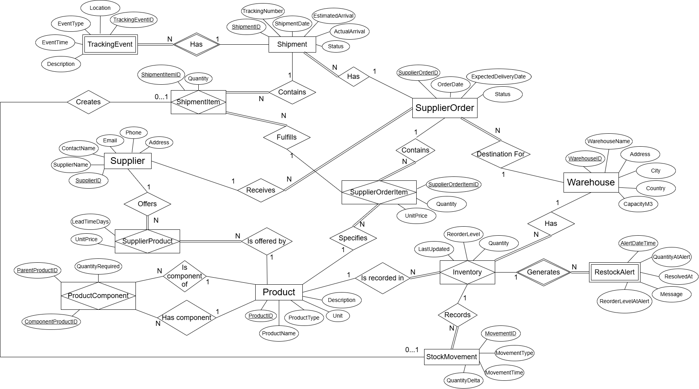
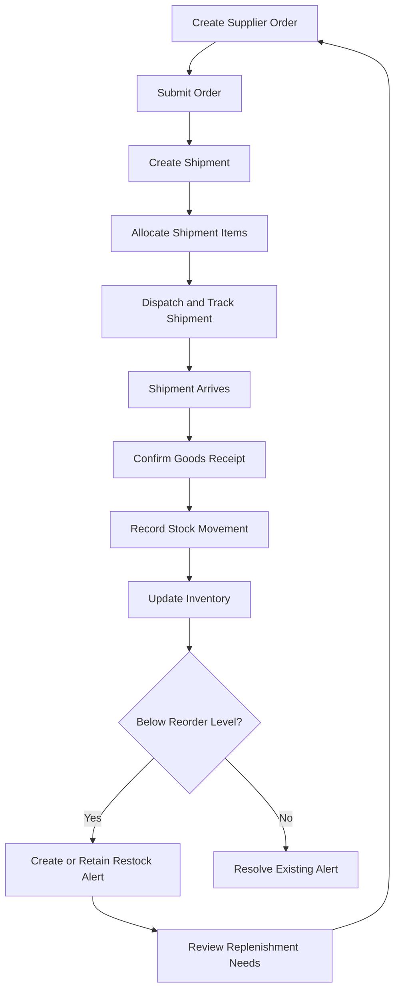

# 📦 Supply Chain & Warehouse Logistics Network


A relational database system designed to manage supply chain operations, warehouse inventory, supplier orders, shipments, product components, and automated restock alerts.

---

## 👥 1. Group Members

| No. | Name | Email |
| --- | --- | --- |
| 1 | Dương Gia Bảo | n24dece055@student.ptithcm.edu.vn |
| 2 | Mạc Thanh Toàn | n24dece096@student.ptithcm.edu.vn |
| 3 | Nguyễn Thanh Tú | n24dece100@student.ptithcm.edu.vn |

## 📌 2. Project Information

| Information | Details |
| --- | --- |
| University | Posts and Telecommunications Institute of Technology (PTIT) |
| Course | Database Systems |
| Topic | 06 - Supply Chain and Warehouse Logistics Network |
| Team | WAG |
| Database Name | `wag_logistics_v61` |
| Database Management System | MySQL 8.0+ |

## 📖 3. Project Overview

The Supply Chain and Warehouse Logistics Network is a database system developed to support procurement, warehouse management, shipment tracking, and inventory control across multiple geographical locations.

The system provides a centralized platform for managing suppliers, products, purchase orders, shipments, stock movements, and multi-level product structures.

It also automatically generates restock alerts when inventory quantities fall below predefined reorder levels.

### Project Objectives

- Manage multiple warehouses across different geographical locations.
- Manage products, suppliers, and supplier offerings.
- Track supplier orders and shipment information.
- Support partial shipments and delivery tracking.
- Maintain accurate inventory balances.
- Support multi-level Bill of Materials (BOM).
- Automatically generate and resolve restock alerts.
- Ensure data integrity through constraints, triggers, and stored procedures.
- Provide analytical SQL queries for business decision-making.

---

## 🗂️ 4. Database Design

### Phase 1 - Conceptual Design

The conceptual design focuses on identifying system requirements, entities, attributes, relationships, cardinalities, and business rules.

The conceptual model includes:

- 11 functional requirements.
- 15 business rules.
- 13 entities.
- 17 relationships.
- Enhanced Entity Relationship (EER) Model.

### Entity Relationship Diagram



### Phase 2 - Relational Design

The conceptual model is transformed into a relational database schema using:

- Primary Keys (PK).
- Foreign Keys (FK).
- Composite Keys.
- Unique Constraints.
- Check Constraints.
- Referential Integrity.

### Relational Schema


### Database Tables

The database consists of 13 tables.

| No. | Table | Description |
| --- | --- | --- |
| 1 | `Warehouse` | Stores warehouse locations and capacity. |
| 2 | `Product` | Stores product information. |
| 3 | `Supplier` | Stores supplier information. |
| 4 | `SupplierProduct` | Manages supplier prices and lead times. |
| 5 | `SupplierOrder` | Stores purchase orders. |
| 6 | `SupplierOrderItem` | Stores products and quantities in each order. |
| 7 | `Shipment` | Manages shipment information and status. |
| 8 | `ShipmentItem` | Manages quantities allocated to shipments. |
| 9 | `TrackingEvent` | Records shipment tracking events. |
| 10 | `ProductComponent` | Represents multi-level product structures. |
| 11 | `Inventory` | Maintains warehouse inventory balances. |
| 12 | `StockMovement` | Records inventory transactions. |
| 13 | `RestockAlert` | Manages current and historical restock alerts. |

---

## ⚙️ 5. MySQL Implementation

The database implementation includes the following components:

| Component | Quantity |
| --- | ---: |
| Database Tables | 13 |
| Views | 2 |
| Triggers | 22 |
| Stored Procedures | 3 |
| Business Queries | 12 |
| Integrity Checks | 5 |

### Main Features

#### Warehouse Management

- Manage warehouses in different locations.
- Store warehouse addresses and storage capacity.
- Monitor product quantities across warehouses.

#### Supplier and Order Management

- Manage supplier information and product offerings.
- Compare supplier prices and lead times.
- Create and submit supplier orders.
- Maintain historical agreed purchase prices.
- Validate supplier order items.

#### Shipment Management

- Support multiple shipments for a supplier order.
- Allocate order quantities to different shipments.
- Prevent shipment quantities from exceeding ordered quantities.
- Track shipment status and delivery events.
- Identify delayed and overdue shipments.

#### Inventory Management

- Maintain inventory balances for each warehouse-product pair.
- Record opening stock, receipts, issues, and adjustments.
- Automatically update inventory after stock movements.
- Prevent negative inventory quantities.
- Maintain an append-only stock movement history.

#### Bill of Materials (BOM)

- Represent parent-component relationships.
- Support multi-level product structures.
- Calculate material requirements using recursive CTEs.
- Prevent direct and indirect circular dependencies.

#### Automated Restock Alerts

- Generate alerts when stock falls below the reorder level.
- Prevent duplicate unresolved alerts.
- Automatically resolve alerts when stock reaches the reorder level.
- Maintain historical alert records.

---

## 🔒 6. Business Rules

The system uses database constraints, triggers, and stored procedures to enforce important business rules.

- New supplier orders must start in Draft status.
- Submitted orders must contain at least one order item.
- Suppliers must offer the products included in their orders.
- Order items can only be modified while the order is in Draft status.
- Shipments must belong to submitted supplier orders.
- Shipment items must belong to the same supplier order.
- Allocated quantities cannot exceed ordered quantities.
- Shipment items can only be received after the shipment arrives.
- Each shipment item can be received in full at most once.
- Inventory quantities cannot become negative.
- Stock movements cannot be updated or deleted.
- Product structures cannot contain circular dependencies.
- Each inventory record can have at most one unresolved restock alert.

### Database Views

| View | Description |
| --- | --- |
| `OpenRestockAlert` | Displays unresolved restock alerts and stock shortages. |
| `AllocatedByOrderItem` | Calculates allocated quantities excluding cancelled shipments. |

### Stored Procedures

| Procedure | Description |
| --- | --- |
| `require_draft_order` | Ensures that only draft order items can be modified. |
| `validate_allocation` | Validates shipment allocation quantities. |
| `sync_alert` | Automatically creates or resolves restock alerts. |

---

## 🔄 7. Business Workflow



---

## 📁 8. Repository Resources

| Resource | Description |
| --- | --- |
| `WAG61-Java-MySQL/` | Java and MySQL project directory. |
| `ERDiagram_Topic6.png` | Entity Relationship Diagram. |
| `Relational_Schema_Topic6.png` | Relational Database Schema. |
| `WAG.docx` | Project report in Word format. |
| `WAG.pdf` | Project report in PDF format. |
| `README.md` | Project documentation. |

### SQL Scripts

| File | Description |
| --- | --- |
| `01_schema_mysql.sql` | Creates database tables, constraints, and views. |
| `02_rules_mysql.sql` | Implements triggers and stored procedures. |
| `03_seed_mysql.sql` | Inserts sample data into the database. |
| `04_queries_mysql.sql` | Contains 12 business queries. |
| `05_verify_mysql.sql` | Verifies database integrity and consistency. |
| `06_demo_receipt.sql` | Demonstrates the goods receipt process. |

---

## 💻 9. Technologies Used

| Technology | Purpose |
| --- | --- |
| MySQL | Database Management System |
| SQL | Database Definition and Manipulation |
| InnoDB | Transactional Storage Engine |
| MySQL Workbench | Database Development and Management |
| Java | Application Development |
| Git | Version Control |
| GitHub | Source Code Management and Documentation |
| Mermaid | Business Workflow Visualization |

### SQL Techniques

- Data Definition Language (DDL).
- Data Manipulation Language (DML).
- Primary and Foreign Keys.
- JOIN Operations.
- Aggregate Functions.
- GROUP BY.
- Subqueries.
- Common Table Expressions (CTEs).
- Recursive CTEs.
- Window Functions.
- Views.
- Triggers.
- Stored Procedures.
- Transactions.
- COMMIT and ROLLBACK.

---

## 🚀 10. Getting Started

### Prerequisites

Before running the project, make sure the following software is installed:

- MySQL Server 8.0.16 or later.
- MySQL Workbench or MySQL Command Line Client.
- Git (optional).

### Step 1 - Clone the Repository

```bash
git clone https://github.com/n24dece055-tech/Database-Topic-6-WAG.git
```

```bash
cd Database-Topic-6-WAG
```

### Step 2 - Initialize the Database

Open MySQL Workbench and connect to your MySQL Server.

Locate the SQL scripts and execute them in the following order:

```text
01_schema_mysql.sql
02_rules_mysql.sql
03_seed_mysql.sql
04_queries_mysql.sql
05_verify_mysql.sql
06_demo_receipt.sql
```

The database will be created with the following name:

```sql
wag_logistics_v61
```

### Step 3 - Select the Database

```sql
USE wag_logistics_v61;
```

### Step 4 - Check Database Tables

```sql
SHOW TABLES;
```

### Step 5 - Explore Sample Data

```sql
SELECT * FROM Warehouse;
SELECT * FROM Product;
SELECT * FROM Supplier;
SELECT * FROM Inventory;
```

### Step 6 - Check Restock Alerts

```sql
SELECT *
FROM OpenRestockAlert
ORDER BY Shortage DESC;
```

> Note: Execute the setup scripts on a fresh database. Adjust script paths and filenames to match their actual locations.

---

## 📊 11. Business Queries

The project provides 12 SQL queries to support business analysis and decision-making.

| ID | Query Description |
| --- | --- |
| Q01 | Display open restock alerts ranked by shortage. |
| Q02 | Calculate total product quantities across all warehouses. |
| Q03 | Compare ordered, allocated, received, and outstanding quantities. |
| Q04 | Retrieve the latest tracking event for each shipment. |
| Q05 | Find the lowest supplier price and shortest lead time among price ties. |
| Q06 | Calculate total submitted order value by supplier. |
| Q07 | Compare agreed purchase prices with current supplier prices. |
| Q08 | Identify delayed and overdue shipments. |
| Q09 | Calculate material requirements using recursive BOM structures. |
| Q10 | Calculate running inventory balances in movement ID order. |
| Q11 | Calculate remaining stock shortages after considering inbound shipments. |
| Q12 | Find suppliers offering every low-stock product at HCMC Central. |

---

## 🧪 12. Database Verification

The verification script checks database consistency, table row counts, and business rule violations.

### Integrity Checks

| Test Case | Expected Violations |
| --- | ---: |
| Inventory ledger balance mismatch | 0 |
| Incorrect open restock alert state | 0 |
| Overallocated supplier order items | 0 |
| Shipment items allocated to the wrong order | 0 |
| Shipment arrival before dispatch | 0 |

All violation counts are expected to be zero.

To verify the database, execute:

```text
05_verify_mysql.sql
```

The verification script also displays the MySQL version and active database schema.

---

## 📦 13. Goods Receipt Demonstration

The `06_demo_receipt.sql` script demonstrates how the system automatically updates inventory and resolves restock alerts when goods are received.

### Demonstration Scenario

| Information | Value |
| --- | --- |
| Warehouse | HCMC Central |
| Product | Worktop |
| Initial Quantity | 5 |
| Received Quantity | 10 |
| Reorder Level | 10 |
| Expected Final Quantity | 15 |
| Expected Alert Status | Resolved |

### Transaction Process

1. Start a database transaction.
2. Check the current inventory quantity.
3. Insert a receipt into the StockMovement table.
4. Automatically update the inventory balance.
5. Automatically resolve the restock alert.
6. Verify the updated inventory quantity.
7. Roll back the transaction.

The demonstration uses `ROLLBACK` to preserve the original sample dataset.

---

## 📚 14. Project Documentation

- [Project Report (PDF)](WAG.pdf)
- [Project Report (Word)](WAG.docx)
- [Entity Relationship Diagram](ERDiagram_Topic6.png)
- [Relational Database Schema](Relational_Schema_Topic6.png)

---

## 🎯 15. Project Scope and Future Development

The current project focuses on procurement, inbound logistics, inventory management, shipment tracking, and product structures.

Potential future improvements include:

- Customer and sales order management.
- Warehouse-to-warehouse transfers.
- Product return management.
- User authentication and authorization.
- Real-time inventory dashboards.
- Automated replenishment recommendations.
- Demand forecasting.
- Shipment route optimization.

---

## 🎓 16. Acknowledgements

This project was developed by Team WAG as part of the Database Systems course at the Posts and Telecommunications Institute of Technology (PTIT).

---

<div align="center">

### Supply Chain & Warehouse Logistics Network

**Database Systems - Topic 06**

Developed by **Team WAG**

Posts and Telecommunications Institute of Technology

</div>
